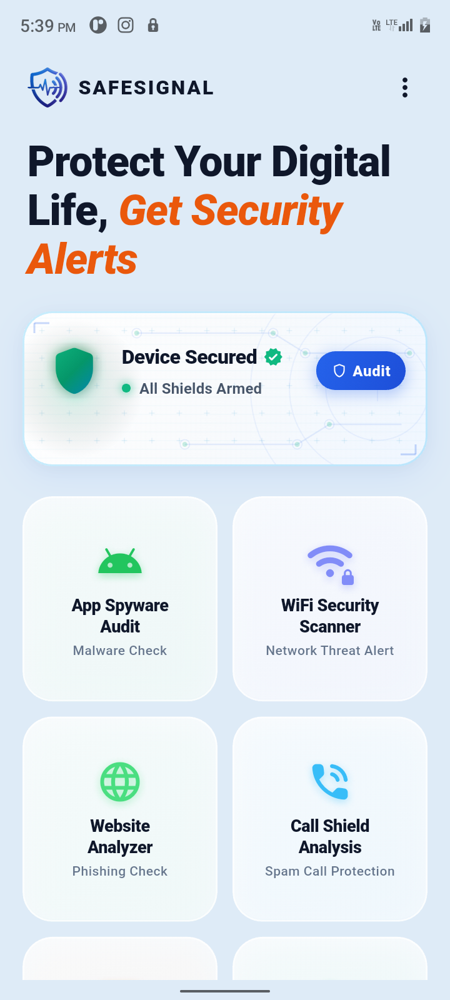
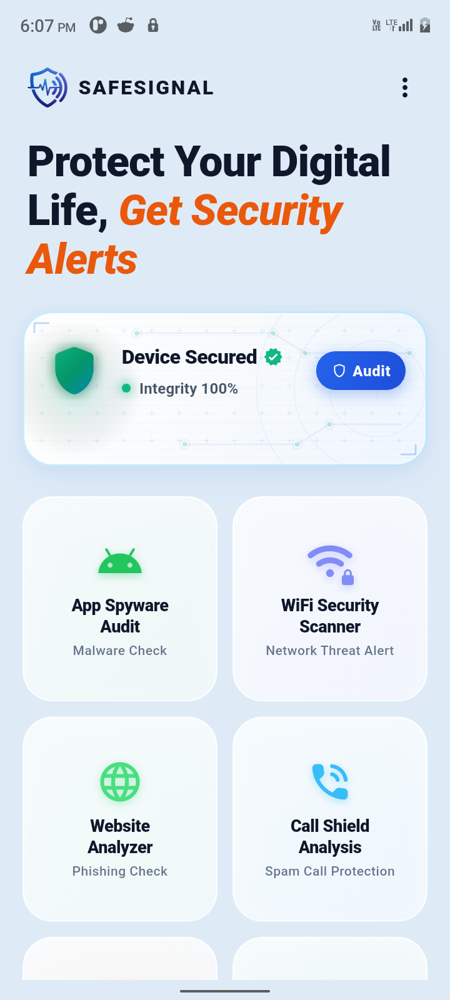
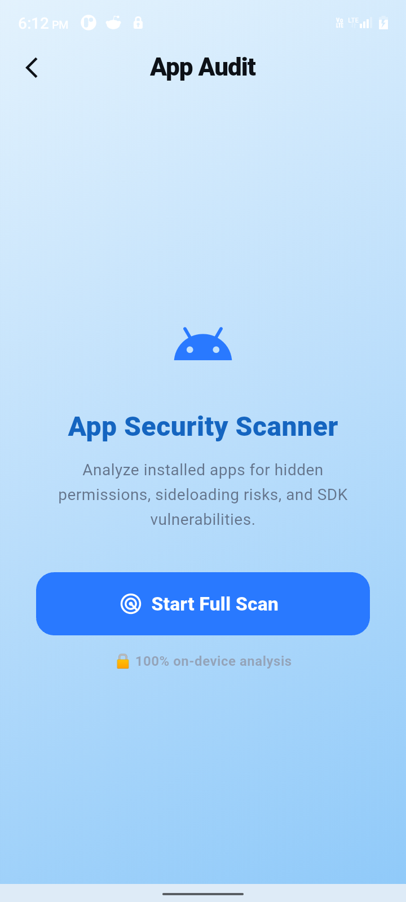
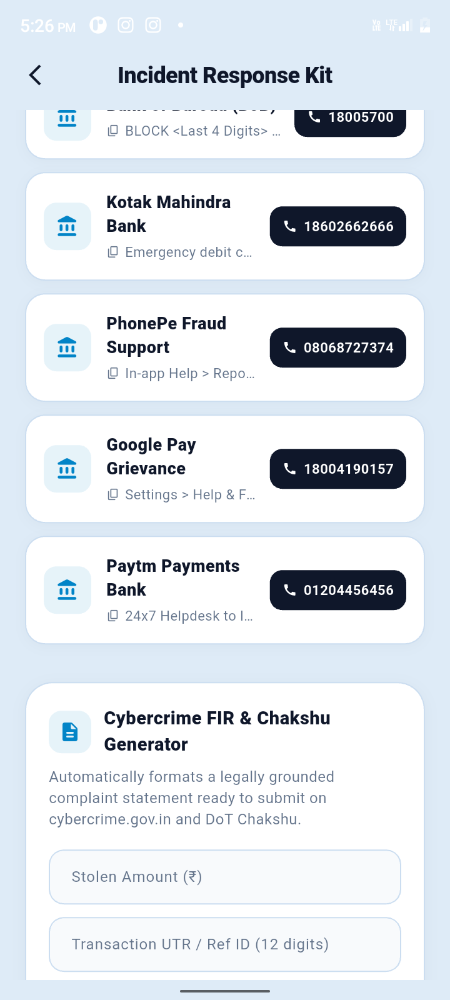
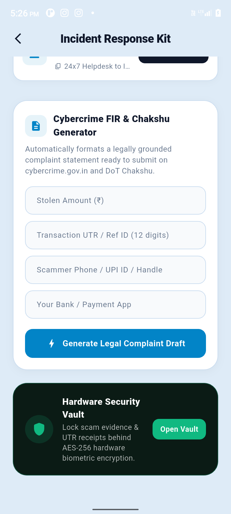

<div align="center">

# 🛡️ SafeSignal

### On-Device Mobile Cyber Defense & Incident Response Suite for Android
**Client-Side Scam Detection • Hardware-Backed Vault (AES-256) • Golden Hour 1930 Incident Response**

[](https://flutter.dev)
[](https://dart.dev)
[](https://developer.android.com)
[](https://safesignal-dx8.pages.dev)
[](https://safesignal-dx8.pages.dev/llms.txt)
[](https://safesignal-dx8.pages.dev/.well-known/security.txt)
[](https://cybercrime.gov.in)
[](https://github.com/UmarFarooqueJi)

<p align="center">
  🌐 <b>Official Website:</b> <a href="https://safesignal-dx8.pages.dev"><b>safesignal-dx8.pages.dev</b></a> • 
  🤖 <b>LLM / AI Spec:</b> <a href="https://safesignal-dx8.pages.dev/llms.txt"><b>llms.txt</b></a> • 
  📦 <b>Application ID:</b> <code>com.safesignal.safesignal</code>
</p>

<p align="center">
  <b>SafeSignal</b> is an open-source, local-first Android security and cyber fraud response application designed to protect users against predatory financial fraud, banking trojans, smishing scams, malicious APK droppers, and privacy leaks. The core analysis engines and cryptographic vaults execute entirely on-device, preserving client privacy while providing instant Golden Hour response tools for cybercrime incidents.
</p>

</div>

---

## ⚠️ Security & Risk Reduction Disclaimer

> [!IMPORTANT]
> **SafeSignal is a defense-in-depth and incident-triage assistance tool.** It detects common scam heuristics, dangerous application permission combinations, and known malicious indicators. It does **not** provide 100% immunity against advanced persistent threats (APTs), zero-day exploits, or targeted firmware attacks. No software can replace vigilance. If you have suffered financial loss due to cyber fraud, report it immediately to the **National Cyber Crime Helpline (1930)** or at [cybercrime.gov.in](https://cybercrime.gov.in).

---

## 📱 Application Interface & Captures

The following captures demonstrate the functional interface of SafeSignal:

<div align="center">

### Core Dashboard & Device Security Audit
| Threat Command Center | Device & OS Exploit Audit | Installed Package Audit |
| :---: | :---: | :---: |
|  |  |  |
| **Real-time threat status & quick actions** | **Root, bootloader & debug check** | **Permission cluster profiling** |

<br>

### Threat Analysis & Golden Hour Incident Response
| Phishing & URL Analyzer | 1930 Emergency Nodal Directory | Section 66D IT Act Legal Draft |
| :---: | :---: | :---: |
|  |  |  |
| **Punycode & domain heuristic check** | **Direct freeze lines for 10+ banks** | **Formal complaint text generation** |

</div>

---

## 🧩 Feature-by-Feature Implementation Status

SafeSignal clearly delineates between on-device logic, hardware-dependent features, and external threat intelligence requests:

| Capability | Module / Implementation | Processing Location | Implementation Status | Notes & Hardware Requirements |
| :--- | :--- | :--- | :--- | :--- |
| **SMS Scam & Smishing Detection** | `LocalRuleEngine` | **100% On-Device** | ✅ Production Verified | Regex & heuristic keyword bank (TRAI DLT headers, electricity scams, APK links). No cloud transmission. |
| **Call Forwarding Hijack Detection** | `LocalRuleEngine` | **100% On-Device** | ✅ Production Verified | Detects `*21*`, `*401*`, and `##002#` short codes in inbound messages. |
| **Remote Access Trojan Detection** | `LocalRuleEngine` | **100% On-Device** | ✅ Production Verified | Flags social engineering vectors promoting AnyDesk, TeamViewer, RustDesk, QuickSupport. |
| **Root & Bootloader Integrity Audit** | `safe_device` + `DeviceAuditScreen` | **100% On-Device** | ✅ Production Verified | Checks `su` binaries, test-keys, Magisk artifacts, and developer debugging flags. |
| **Sensor & Permission Profiling** | Android `PackageManager` | **100% On-Device** | ✅ Production Verified | Identifies dangerous permission clusters (`READ_SMS` + `RECORD_AUDIO` + `SYSTEM_ALERT_WINDOW`). |
| **Biometric Master Key Storage** | `FlutterSecureStorage` | **100% On-Device** | ✅ Production Verified | Uses Android KeyStore (RSA-OAEP / AES-GCM) backed by TEE / StrongBox hardware where available. |
| **Document Vault Encryption** | `VaultCryptoService` | **100% On-Device** | ✅ Production Verified | AES-256-CBC with volatile RAM processing, random IV, and SHA-256 integrity checksums. Plaintext shredded from disk. |
| **Document Optical Character Recognition** | `google_mlkit_text_recognition` | **100% On-Device** | ✅ Production Verified | Runs on-device ML Kit vision models; zero remote processing. |
| **1930 Golden Hour Emergency Dialer** | `IncidentResponseScreen` | **Native Android Intent** | ✅ Production Verified | Initiates direct `tel:1930` calls through standard telephony intents. |
| **Emergency Bank Freeze Directory** | `IncidentResponseScreen` | **100% On-Device** | ✅ Production Verified | Pre-loaded nodal freeze lines & SMS blocking templates for 10+ major Indian financial institutions. |
| **Section 66D IT Act Legal FIR Generator** | `IncidentResponseScreen` | **100% On-Device** | ✅ Production Verified | Generates structured formal complaint text with UTR, amount, and scammer details for cybercrime portals. |
| **Domain & URL Threat Reconnaissance** | `SafeSignalThreatGateway` | **External Network Call** | ⚠️ Network Dependent | Queries RDAP (`rdap.org`), Cloudflare DoH (`cloudflare-dns.com`), and URLhaus API (`abuse.ch`). |
| **Data Breach Monitor** | `HibpService` | **External Network Call** | ⚠️ Network Dependent | Queries public breach databases (XposedOrNot API). Only invoked upon explicit user request. |
| **Cyber Threat & Advisory Feed** | `CyberFeedScreen` | **External Network Call** | ⚠️ Network Dependent | Pulls open public RSS feeds (Google News Cyber India, The Hacker News) with local caching. |
| **Real-time SMS Interception (Background)** | `SmsReceiver.kt` | **Android Broadcast Receiver** | ⚡ Platform Dependent | Requires default SMS handler or explicit runtime permissions depending on Android OEM policy. |

---

## 🔒 Privacy Architecture & Network Communication

SafeSignal adheres to strict data minimization. By default, **no personal data, contacts, messages, or files are sent to any server.**

### External Network Communication Matrix

| Feature | Destination Endpoint | Transport | Payload Transmitted | User Consent / Trigger |
| :--- | :--- | :--- | :--- | :--- |
| **Domain Intelligence** | `https://rdap.org/domain/{domain}` | HTTPS (TLS 1.3) | Domain hostname only | Manual "Analyze URL" click |
| **DNS-over-HTTPS** | `https://cloudflare-dns.com/dns-query` | HTTPS (TLS 1.3) | Hostname DNS query | Manual "Analyze URL" click |
| **Malware URL Check** | `https://urlhaus-api.abuse.ch/v1/url/` | HTTPS (TLS 1.3) | Submitted target URL | Manual "Analyze URL" click |
| **Email Breach Check** | `https://api.xposedornot.com/v1/check-email/` | HTTPS (TLS 1.3) | User-entered email query | Manual "Check Breach" button |
| **Cyber News Feed** | Google News / The Hacker News RSS | HTTPS (TLS 1.3) | None (Standard HTTP GET) | Opening Cyber Feed tab |

---

## 🛡️ Threat Model & Limitations

### In-Scope Threats Addressed
- **Smishing & Social Engineering**: Catches fraudulent SMS patterns impersonating banks, TRAI DLT registration spoofing, electricity disconnection deadlines, and lottery traps.
- **APK Dropper Distribution**: Warns users when messages contain links directing to raw `.apk` payloads or untrusted file shares.
- **Credential & OTP Siphoning**: Identifies social engineering patterns attempting to extract OTPs or banking PINs.
- **Over-Privileged Sideloads**: Audits applications installed outside verified app stores requesting sensitive hardware sensors or administrative overlay capabilities.
- **Identity Document Exposure**: Protects scanned credentials (Aadhaar, PAN, voter cards) via encrypted local storage rather than plain gallery folders.

### Out-of-Scope & Known Limitations
- **OS Kernel Exploits & Hardware Zero-Days**: If the underlying Android operating system is compromised at root/kernel level, process isolation and KeyStore protections may be bypassed.
- **OEM-Specific Background Restrictions**: Aggressive battery managers (MIUI, ColorOS, FunTouch) may terminate background receivers unless battery optimization is manually disabled by the user.
- **Real-time Call Audio Inspection**: SafeSignal does not record or analyze live telephone conversations to maintain user privacy and comply with Android permission restrictions.
- **Dynamic Phishing Content**: Phishing pages utilizing time-delayed cloaking or CAPTCHAs cannot be fully evaluated through static URL inspection alone.

---

## 📋 Android Permissions Explanation

SafeSignal requests only the permissions necessary for its explicit security functions:

| Android Permission | Justification & Usage | Protection Level |
| :--- | :--- | :--- |
| `android.permission.RECEIVE_SMS` | Captures incoming SMS broadcasts to run client-side smishing checks. | Dangerous (Runtime Grant) |
| `android.permission.READ_SMS` | Allows user-initiated scanning of the existing SMS inbox for scam patterns. | Dangerous (Runtime Grant) |
| `android.permission.QUERY_ALL_PACKAGES` | Required on Android 11+ to inspect installed packages for dangerous permission combinations and sideloaded signatures. | High-Risk (Restricted) |
| `android.permission.USE_BIOMETRIC` | Prompts for fingerprint or device biometrics to unlock the encrypted document vault. | Normal |
| `android.permission.CALL_PHONE` | Allows direct one-touch dialing of the 1930 National Cyber Helpline and bank freeze lines. | Dangerous (Runtime Grant) |
| `android.permission.POST_NOTIFICATIONS` | Delivers real-time notifications when a high-risk SMS or dropper is detected. | Dangerous (Android 13+) |
| `android.permission.INTERNET` | Fetches DoH queries, RDAP domain info, email breach checks, and public RSS feeds upon request. | Normal |

---

## 🛠️ Build & Development Environment

### Prerequisites
- **Flutter SDK**: `3.38.8` (or compatible stable `3.x`)
- **Dart SDK**: `3.10.7`+
- **JDK**: Java 17 (OpenJDK 17 recommended)
- **Android SDK**: Build tools 34.0.0, compileSdk 34, minSdk 26
- **Architecture**: ARM64-v8a, ARMeabi-v7a, x86_64

### Compilation Steps

```bash
# 1. Clone repository
git clone https://github.com/UmarFarooqueJi/SafeSignal.git
cd SafeSignal/safesignal

# 2. Fetch dependencies
flutter pub get

# 3. Verify static analysis
flutter analyze --no-fatal-infos

# 4. Run automated test suite
flutter test

# 5. Build signed production APK
flutter build apk --release
```

The resulting binary will be generated at `build/app/outputs/flutter-apk/app-release.apk`.

---

## 🧪 Testing

SafeSignal contains unit and smoke test suites covering core functionality:

```bash
# Execute all test suites
flutter test

# Run individual test files
flutter test test/rule_engine_test.dart
flutter test test/url_analysis_test.dart
flutter test test/vault_crypto_test.dart
flutter test test/incident_response_test.dart
flutter test test/widget_test.dart
```

---

## 🌐 Supported Platforms & Languages

- **Operating System**: Android 8.0 Oreo (API level 26) through Android 15 (API level 35).
- **Languages**: English (default interface) with bilingual Hindi scam detection patterns and cyber feed content.

---

## 📄 License & Open-Source Status

This repository is currently governed by the **SafeSignal Source-Available License v1.0** (located in [LICENSE](LICENSE)).

> [!NOTE]
> Under the Source-Available License, developers and researchers may study, audit, build, and use SafeSignal for personal and educational security research. Redistribution, commercial derivation, and removal of attribution are restricted. An evaluation of transitioning to a standard OSI-approved license (such as MIT or Apache 2.0) is maintained under project governance.

---

## 🤝 Contributing

Contributions that enhance rule accuracy, expand Indian banking helpline coverage, or improve device auditing are welcome. Please read [CONTRIBUTING.md](CONTRIBUTING.md) for details on code style, commit standards, and PR workflows.

---

## 🔐 Security Vulnerabilities & Disclosure

If you discover a security vulnerability within SafeSignal, please review our [Security Policy](SECURITY.md) and report it responsibly via GitHub Private Vulnerability Reporting. Do not report security vulnerabilities via public GitHub issues.

---

## 👤 Author & Maintainer

**Umar Farooque**  
GitHub: [@UmarFarooqueJi](https://github.com/UmarFarooqueJi)  
Official Portal: [safesignal-dx8.pages.dev](https://safesignal-dx8.pages.dev)
